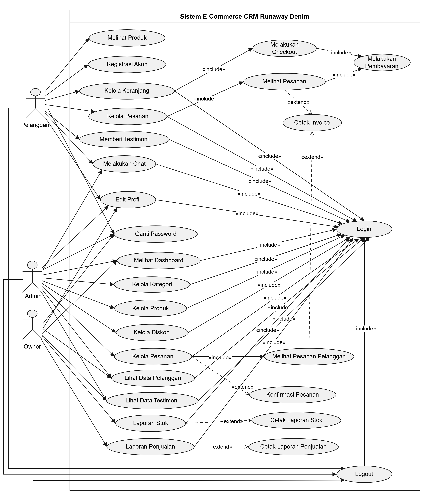
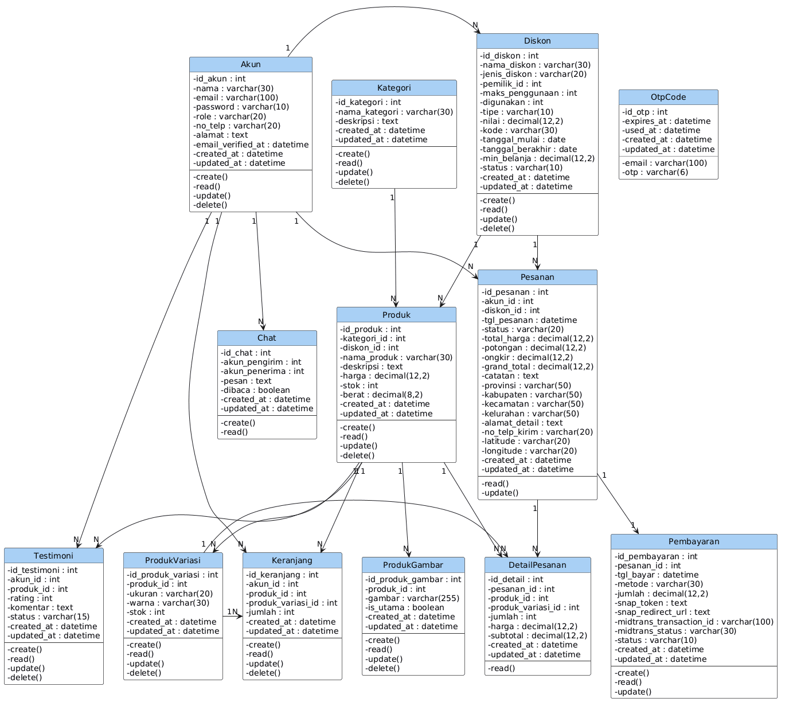

# 🛒 Runaway Denim — CRM E-Commerce

**Sistem Informasi CRM** berbasis website untuk **Runaway Denim** — toko jeans denim. Dibangun dengan **Laravel 13 + Inertia.js v3 + React 19**.

---

## 📸 Diagrams

### Use Case Diagram



### Class Diagram



---

## ✨ Fitur

| Fitur                   | Keterangan                                                   |
| ----------------------- | ------------------------------------------------------------ |
| **Role-based access**   | Pelanggan, Admin, Owner — masing-masing punya hak akses      |
| **Manajemen produk**    | Kategori, variasi (ukuran + warna), multiple gambar, diskon  |
| **Keranjang & Checkout** | CRUD keranjang, form alamat (provinsi sampai kelurahan)     |
| **Pembayaran Midtrans** | Snap payment gateway, callback, status pembayaran            |
| **Pesanan**             | Multi-status: pending → dibayar → dipacking → dikirim → selesai |
| **Testimoni**           | Rating & komentar, moderasi admin/owner                      |
| **Chat**                | Chat real-time antara pelanggan dan admin                    |
| **Laporan Owner**       | Stok & penjualan, cetak PDF                                  |
| **Autentikasi**         | Register (OTP), login, forgot password, verifikasi email     |
| **Keamanan**            | Passkeys (WebAuthn), Two-Factor Authentication (2FA)         |

---

## 🧰 Tech Stack

| Bagian       | Teknologi                                   |
| ------------ | ------------------------------------------- |
| **Backend**  | PHP 8.3, Laravel 13                         |
| **Frontend** | React 19, TypeScript, Inertia.js v3         |
| **Styling**  | Tailwind CSS v4, Radix UI, Lucide icons     |
| **Build**    | Vite 8                                      |
| **Database** | MySQL 8.0+                                  |
| **Payment**  | Midtrans Snap                               |
| **Auth**     | Laravel Fortify, Passkeys (WebAuthn)        |
| **Testing**  | Pest PHP 4, PHPStan, Laravel Pint           |

---

## 💻 Requirements

- PHP **^8.3** (extensions: `pdo_mysql`, `mbstring`, `xml`, `curl`, `gd`, `fileinfo`, `bcmath`, `zip`, `openssl`)
- [Composer](https://getcomposer.org) v2
- Node.js **20+** & NPM
- MySQL **8.0+**
- Git (opsional)

---

## 🚀 Instalasi

### 1. Clone & masuk folder

```bash
git clone https://github.com/Liando18/sistem-informasi-crm-runaway.git runaway-denim
cd runaway-denim
```

### 2. Setup environment

```bash
cp .env.example .env
```

Edit `.env` — sesuaikan **database**, **Midtrans key**, dan **email SMTP**.

### 3. Install dependencies

```bash
composer install
npm install
```

### 4. Generate key & migrate

```bash
php artisan key:generate
php artisan migrate
php artisan db:seed
php artisan storage:link
```

### 5. Build & jalankan

**Production:**
```bash
npm run build
php artisan serve
```

**Development (hot-reload):**
```bash
composer run dev
```
Atau manual:
```bash
npm run dev     # terminal 1 — Vite
php artisan serve  # terminal 2 — Laravel
```

Buka **http://localhost:8000**

---

## 🔑 Akun Default (Seeder)

| Role      | Email                       | Password   |
| --------- | --------------------------- | ---------- |
| Admin     | `admin@runawaydenim.com`    | `admin123` |
| Pelanggan | `customer@runawaydenim.com` | `admin123` |
| Owner     | `owner@runawaydenim.com`    | `admin123` |

---

## 📄 Environment Variables (`.env`)

### Database

```env
DB_CONNECTION=mysql
DB_HOST=127.0.0.1
DB_PORT=3306
DB_DATABASE=runaway_denim
DB_USERNAME=root
DB_PASSWORD=
```

### Midtrans

```env
MIDTRANS_SERVER_KEY=your-server-key
MIDTRANS_CLIENT_KEY=your-client-key
MIDTRANS_IS_PRODUCTION=false
```

### Email (OTP)

```env
MAIL_MAILER=smtp
MAIL_HOST=smtp.gmail.com
MAIL_PORT=587
MAIL_USERNAME=your-email@gmail.com
MAIL_PASSWORD=your-app-password
MAIL_ENCRYPTION=tls
```

### Session & Cache

```env
SESSION_DRIVER=file
SESSION_LIFETIME=120
CACHE_STORE=file
QUEUE_CONNECTION=sync
```

---

## 🧭 Route Structure

### Public

| Method | URI                | Deskripsi        |
| ------ | ------------------ | ---------------- |
| GET    | `/`                | Beranda          |
| GET    | `/produk`          | Daftar produk    |
| GET    | `/produk/{produk}` | Detail produk    |
| GET    | `/tentang`         | Tentang & kontak |
| GET    | `/register`        | Halaman register |
| GET    | `/forgot-password` | Lupa password    |

### Customer (auth + verified)

| Method | URI                          | Deskripsi              |
| ------ | ---------------------------- | ---------------------- |
| GET    | `/dashboard`                 | Dashboard (redirect)   |
| GET    | `/keranjang`                 | Keranjang belanja      |
| POST   | `/keranjang/tambah/{produk}` | Tambah ke keranjang    |
| PATCH  | `/keranjang/{keranjang}`     | Update jumlah          |
| DELETE | `/keranjang/{keranjang}`     | Hapus item             |
| GET    | `/checkout`                  | Halaman checkout       |
| POST   | `/checkout/proses`           | Proses checkout        |
| GET    | `/pesanan`                   | Daftar pesanan         |
| GET    | `/pesanan/{pesanan}`         | Detail pesanan         |
| GET    | `/pesanan/{pesanan}/invoice` | Cetak invoice          |
| GET    | `/pembayaran/pilih/{pesanan}` | Pilih metode bayar     |
| GET    | `/pembayaran/snap/{pesanan}` | Midtrans Snap          |
| POST   | `/pembayaran/callback`       | Midtrans callback      |
| POST   | `/testimoni/{produk}`        | Kirim testimoni        |
| GET    | `/chat`                      | Chat dengan admin      |

### Admin (auth + verified + role:admin)

| Method | URI                               | Deskripsi             |
| ------ | --------------------------------- | --------------------- |
| GET    | `/admin/dashboard`                | Dashboard admin       |
| CRUD   | `/admin/produk`                   | Manajemen produk      |
| CRUD   | `/admin/kategori`                 | Manajemen kategori    |
| CRUD   | `/admin/diskon`                   | Manajemen diskon      |
| GET    | `/admin/pesanan`                  | Data pesanan          |
| PATCH  | `/admin/pesanan/{pesanan}/status` | Update status pesanan |
| GET    | `/admin/pembayaran`               | Data pembayaran       |
| PATCH  | `/admin/pembayaran/{id}/konfirmasi` | Konfirmasi bayar    |
| GET    | `/admin/pelanggan`                | Data pelanggan        |
| GET    | `/admin/chat`                     | Chat dengan pelanggan |
| GET    | `/admin/testimoni`                | Moderasi testimoni    |

### Owner (auth + verified + role:owner)

| Method | URI                              | Deskripsi           |
| ------ | -------------------------------- | ------------------- |
| GET    | `/owner/dashboard`               | Dashboard owner     |
| GET    | `/owner/laporan/stok`            | Laporan stok        |
| GET    | `/owner/laporan/stok/cetak`      | Cetak laporan stok  |
| GET    | `/owner/laporan/penjualan`       | Laporan penjualan   |
| GET    | `/owner/laporan/penjualan/cetak` | Cetak PDF penjualan |
| GET    | `/owner/pelanggan`               | Data pelanggan      |
| GET    | `/owner/testimoni`               | Modersi testimoni   |

---

## 📦 Scripts

```bash
# Development (serve + queue + vite)
composer run dev

# Laravel Pint (PHP CS Fixer)
composer run lint

# PHPStan (PHP static analysis)
composer run types:check

# Prettier (format frontend)
npm run format

# ESLint
npm run lint

# TypeScript type check
npm run types:check

# Test
composer run test

# Full CI check
composer run ci:check

# Setup otomatis (install + migrate + build)
composer run setup
```

---

## 🗄️ Database Structure

**15 tabel utama:**

`akun`, `kategori`, `diskon`, `produk`, `produk_gambar`, `produk_variasi`, `keranjang`, `pesanan`, `detail_pesanan`, `pembayaran`, `testimoni`, `chat`, `password_reset_tokens`, `sessions`, `cache`, `jobs`

### Relasi Kunci

```
produk ──→ kategori (M:1)
produk ──→ diskon (M:1)
produk ──→ produk_gambar (1:M)
produk ──→ produk_variasi (1:M)
akun ──→ keranjang (1:M)
akun ──→ pesanan (1:M)
akun ──→ testimoni (1:M)
pesanan ──→ detail_pesanan (1:M)
pesanan ──→ pembayaran (1:1)
```

---

## 📝 Lisensi

[MIT](LICENSE)
